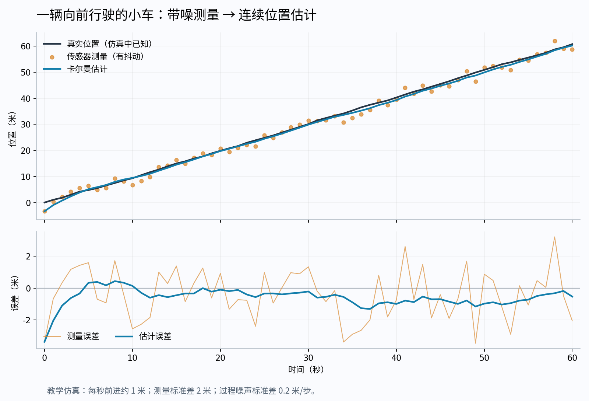

想象一下，你正在给一辆机器人小车做定位。

小车的轮子转了几圈，里程计告诉你：“按我的计算，我们现在应该在 **10 米处**。”与此同时，GPS 告诉你：“我测到的位置是 **12 米**。”

问题来了：**小车到底在哪儿？**

相信里程计？轮子可能打滑。相信 GPS？卫星信号可能漂移。取平均，算成 11 米？可以，但如果 GPS 明显比里程计准确，为什么还要各信一半？

卡尔曼滤波，就是用来解决这类问题的。

> **它根据运动规律预测状态，再用新的测量修正预测；哪一边更可靠，就给哪一边更大的权重。**

这里的“状态”，可以是位置、速度、朝向，也可以是电池剩余电量等无法直接准确获取的量。

## 一、机器人遇到的第一个难题：谁都不完全靠谱

我们平时容易觉得：装上一个传感器，读取它的数值，就知道真实情况了。但传感器给出的，其实是**带误差的观测**。

一辆匀速前进的小车，GPS 的读数却可能一会儿偏前，一会儿偏后，有时还会突然“跳”一下。如果机器人完全按照这些读数行动，它可能会误以为自己突然加速、后退，甚至瞬间移动。

那干脆不看传感器，只靠计算呢？也不行。

“速度 × 时间”算出来的位置，依赖于速度准确、运动规律正确。遇到轮子打滑、地面颠簸或突然加速，预测也会偏离实际。

所以，机器人面对的是两种不确定：

| 信息来源 | 能提供什么 | 为什么会出错 |
| --- | --- | --- |
| 运动模型 | 根据过去推算现在 | 真实运动不完全符合假设 |
| 传感器测量 | 提供当前的外部观测 | 噪声、遮挡、漂移等 |

**卡尔曼滤波把这两份不完美的信息结合起来。**

## 二、先不看公式：它就像一个会权衡的判断者

回到小车的例子：预测位置是 10 米，GPS 测量是 12 米。

如果预测不太可靠，而 GPS 比较准，合理的结果就应该更靠近 12 米。例如：

新估计 = 20% × 10 + 80% × 12 = <strong>11.6 米</strong>

反过来，如果 GPS 信号很差，而小车的运动预测很可靠，结果就应该更靠近 10 米。

这里真正重要的问题是：**“谁更可靠”，怎么用数字表示？**

卡尔曼滤波用**误差方差**表示不确定程度。你可以先把它理解成：误差通常有多分散。

- 方差小：估计通常比较集中，可靠程度高。
- 方差大：估计可能偏得更远，可靠程度低。

注意：方差是对误差的统计描述，不是说“这一次一定错了多少”。

## 三、卡尔曼滤波的工作流程，其实只有两步

**第一步：预测。** 根据上一次的估计和运动规律，推算现在的状态。例如：上一秒在 8 米处，速度约为 2 米/秒，那么现在预测在 10 米处。

**第二步：修正。** 收到传感器的新测量后，比较它与预测的差距，再修正预测。例如：GPS 测到 12 米，比预测多了 2 米。根据 GPS 的可靠程度，决定向它靠近多少。

<figure class="kf-flow" aria-label="卡尔曼滤波预测与修正循环">

上一次的估计 <strong>位置 8 米，速度 2 米/秒</strong>

↓

① 预测：过了 1 秒 <strong>预测位置 10 米，同时计算预测误差</strong>

↓

新观测进入：GPS 测到 <strong>12 米</strong> 同时考虑 GPS 测量误差

↓

② 修正：按可靠程度加权 <strong>新估计 11.6 米，同时更新估计误差</strong>

↓

进入下一秒 <strong>以这次估计为起点，再预测、再修正</strong>

<figcaption>图 1：预测 → 新测量 → 修正 → 下一次预测。</figcaption>
</figure>

这个过程会持续重复。每一次更新，既得到一个新的状态估计，也得到“对这个估计有多大把握”。

## 四、最核心的公式，可以直接读成一句人话

<strong>新估计 = 预测值 + K ×（测量值 − 预测值）</strong>

逐项翻译：

| 公式里的量 | 通俗理解 |
| --- | --- |
| 预测值 | 我原本认为现在应该是多少 |
| 测量值 − 预测值 | 新观测与我的预期差了多少 |
| K | 这次应该接受多少修正 |
| 新估计 | 综合判断后的结果 |

其中，K 叫**卡尔曼增益**。对于这里的一维直接测量问题，可以把它理解成“测量的权重”：

- K = 0.1：只接受差距的 10%，主要相信预测。
- K = 0.5：接受差距的一半。
- K = 0.9：接受差距的 90%，主要相信测量。

例如 K = 0.8：

新估计 = 10 + 0.8 × (12 − 10) = <strong>11.6 米</strong>

**它不是直接用测量覆盖预测，而是根据测量的可靠程度，调整预测。**

## 五、关键来了：权重是怎么算出来的？

在最简单的一维情况下：

<strong>K = P / (P + R)</strong>

- P：**本次预测**的误差方差。
- R：传感器测量的误差方差。

假设 P = 4 米²，R = 1 米²。预测误差较大，测量误差较小，所以：

K = 4 / (4 + 1) = <strong>0.8</strong>

也就是说，测量占 80%，预测占 20%。你可以调整下面的两种误差，观察融合位置怎样变化：

交互示意图请查看博客网页版。

为什么分子是预测误差 P？因为 **K 表示测量权重**。自己的预测越不准，就越应该接受测量的修正。

## 六、这个公式不是拍脑袋想出来的

它来自一个明确的数学目标：**让融合结果的平均平方误差尽可能小。**

下面只推导最简单的版本，不需要矩阵。把预测值记为 a，测量值记为 z，我们想求一个加权结果：

x̂ = (1 − K)a + Kz

假设预测和测量的误差均值为零、互不相关，误差方差分别为 P、R，那么融合误差的方差就是：

V(K) = (1 − K)²P + K²R

这里的平方来自方差的性质：**一个误差乘以权重，其方差就乘以权重的平方。**

为了找到最小值，对 K 求导：

dV/dK = −2(1 − K)P + 2KR

令导数等于零，整理得到：

K(P + R) = P <strong>K = P / (P + R)</strong>

这就解释了：**“更相信可靠的信息”这个直觉，如何变成一个可以计算的权重。**

如果再采用高斯分布描述误差，同样的结果也可以从贝叶斯更新推出来：把“看到测量之前的判断”与“新观测提供的信息”结合，得到更新后的判断。

## 七、为什么下一次的权重还可能变化？

因为不确定性也会随时间变化。这里要认识第三个量：**过程噪声 Q**。

它描述的是：从上一时刻推到这一时刻，运动模型又引入了多少不确定性。例如，你假设小车匀速行驶，但实际可能发生轻微加速、打滑。这些无法被简单模型完全解释的变化，就需要通过 Q 来描述。

对于“位置加上已知位移”的简单模型，预测误差按下面的方式增长：

P预测 = P上次更新后 + Q

收到新测量并完成融合后：

P更新后 = (1 − K)P预测

按模型向前推 → 引入不确定性 → 获得测量 → 融合信息 → 继续向前推

用刚才的例子算一轮：

P更新后 = (1 − 0.8) × 4 = <strong>0.8 米²</strong>

假设下一步的过程噪声 Q = 0.2 米²，那么：

P下一次预测 = 0.8 + 0.2 = <strong>1 米²</strong>

如果 GPS 的测量方差仍为 1 米²，下一次的增益就变成：

K = 1 / (1 + 1) = <strong>0.5</strong>

**即使传感器没有变，算法对自身预测的把握变了，权重也会改变。** 在某些稳定条件下，增益也可能逐渐趋于固定值。

| 符号 | 表示什么 | 一句话记忆 |
| --- | --- | --- |
| P | 估计误差方差；多维时为协方差矩阵 | 我对当前估计有多大把握 |
| Q | 过程噪声方差；多维时为协方差矩阵 | 模型每一步会引入多少不确定性 |
| R | 测量噪声方差；多维时为协方差矩阵 | 传感器通常有多不准 |

## 八、连续运行起来，会是什么效果？

下面是一组教学仿真：小车每秒大约前进 1 米，实际运动有轻微扰动，位置传感器的读数也有噪声。

<figure><figcaption>图 2：卡尔曼滤波跟踪小车的教学仿真，非实测性能数据。</figcaption></figure>

上图中，橙色测量点在真实轨迹附近上下波动，蓝色估计线则结合运动规律，持续跟踪小车。下图把误差单独画出来，可以更清楚地看到：这组仿真里，融合后的误差通常比原始测量更小。

但要注意两点：

**真实位置只在这组仿真中已知。** 实际机器人运行时，算法只能根据模型和传感器做估计。

**看起来平滑，并不等于一定准确。** 一条跟不上真实转弯的平滑轨迹，同样可能是错误结果。

## 九、它与“取平均”有什么区别？

普通平均把参与计算的数据一视同仁。移动平均通常把最近几次测量放在一起求平均，可以减少抖动，但在目标运动变化时可能出现滞后。

卡尔曼滤波还会考虑：

- 物体按照什么规律运动。
- 当前预测有多不确定。
- 新测量有多不确定。
- 状态之间有什么联系，例如位置与速度的联系。

所以，它既能处理噪声，也能利用运动规律跟踪变化。

它还有一个适合实时系统的特点：**在模型假设成立时，过去的信息可以通过“当前估计和误差协方差”递推传递，不必每次从头处理全部历史数据。**

## 十、为什么它在机器人里这么常见？

因为机器人的传感器往往各有所长，也各有缺陷。

例如，惯性测量单元 IMU 响应快，可以感知加速度和角速度；但依靠它积分得到位置，误差会随着时间积累。GPS 能提供绝对位置参考，但可能更新较慢，也可能受遮挡影响。将两者结合，就有机会互相补充。

<figure class="kf-flow" aria-label="机器人传感器与状态估计的关系">

IMU / 轮速计 <strong>提供运动变化信息</strong>

GPS / 相机 / 激光雷达 <strong>提供位置或环境观测</strong>

↓

状态预测与测量融合 <strong>KF 或其非线性变体</strong>

↓

<strong>位置、速度、姿态估计</strong>

↓

<strong>导航与运动控制</strong>

<figcaption>图 3：传感器提供信息，状态估计算法融合信息，再供导航与控制使用。</figcaption>
</figure>

常见应用包括：

| 场景 | 想估计什么 | 有什么作用 |
| --- | --- | --- |
| 移动机器人定位 | 位置、速度、朝向 | 帮助机器人判断自己在哪里 |
| 无人机飞行 | 姿态、速度、高度 | 为稳定飞行提供状态反馈 |
| 雷达跟踪 | 目标位置和速度 | 连续跟踪车辆、飞机等目标 |
| 视频目标跟踪 | 目标位置、运动趋势 | 短暂漏检时继续预测目标位置 |
| 电池管理 | 剩余电量等内部状态 | 综合电流、电压和电池模型估计电量 |

实际机器人中的旋转、运动和测量关系经常是非线性的，因此常见的是**扩展卡尔曼滤波 EKF**、**无迹卡尔曼滤波 UKF** 等变体。它们很重要，但机器人也会采用图优化、粒子滤波等方法，具体取决于任务。

## 十一、最后避开三个常见误解

### 误解一：卡尔曼滤波能自动知道谁更准确

它根据你提供的模型、Q、R 等信息计算权重。标准算法不会凭空知道 GPS 是否已经变差，工程上通常还需要噪声标定、质量判断或自适应处理。

### 误解二：传感器越多，结果就一定越好

如果不同传感器的误差存在相关性，却被当成独立信息融合，就可能重复计算信息，让系统过度自信。

### 误解三：它能保证每一次都更接近真值

它优化的是统计意义上的误差。在线性模型和相应高斯噪声等条件成立时，标准卡尔曼滤波具有最小均方误差意义下的最优性；模型错误、持续偏差和异常测量都会影响效果。

学到这里，再看最开始的公式：

<strong>新估计 = 预测 + 修正权重 ×（观测 − 预测）</strong>

它表达的是一个很实用的判断过程：**先根据已有信息作出预测，再根据新证据调整判断，同时持续记录自己有多不确定。**
