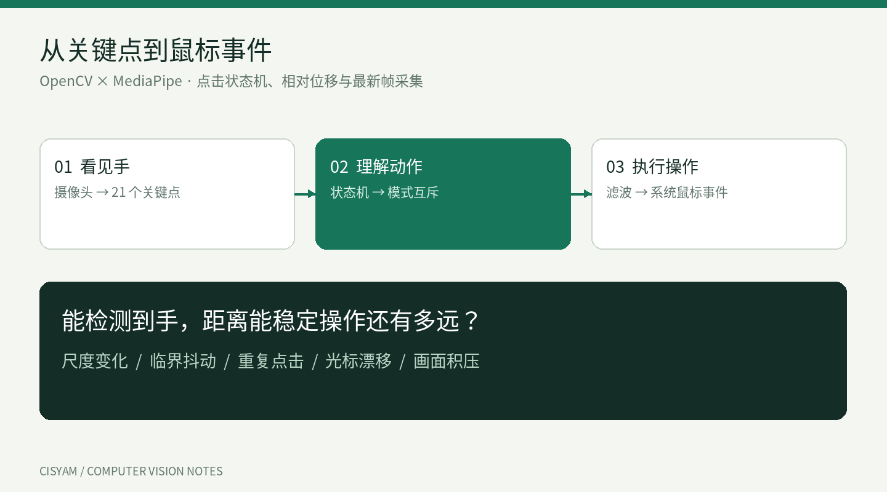
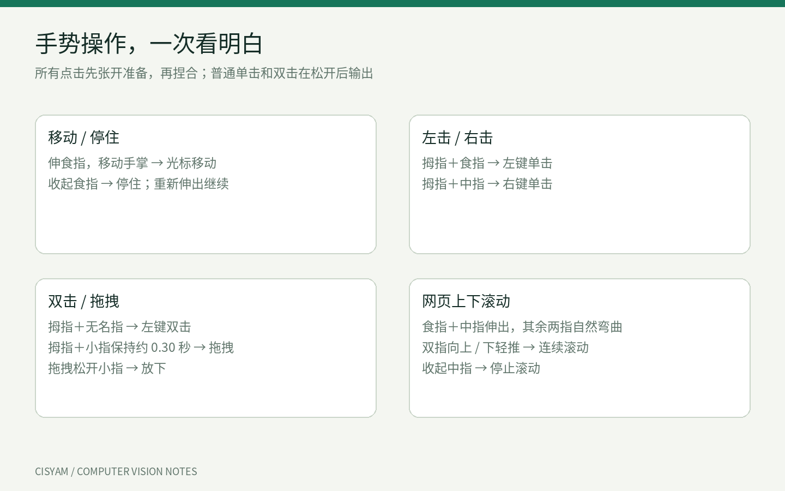
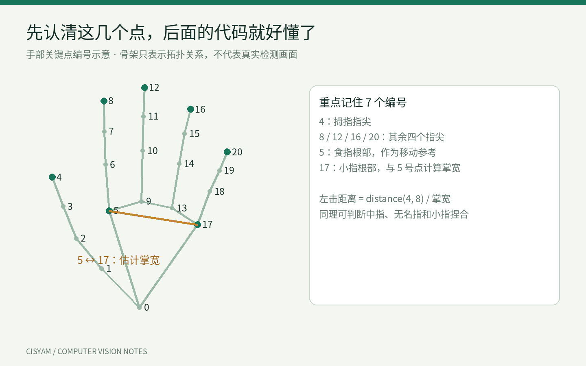
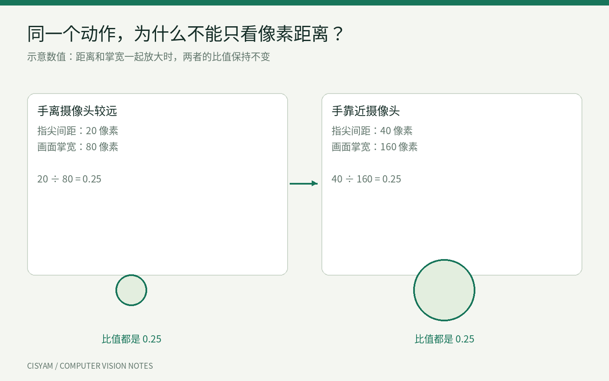
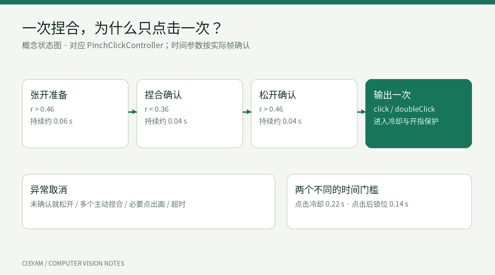
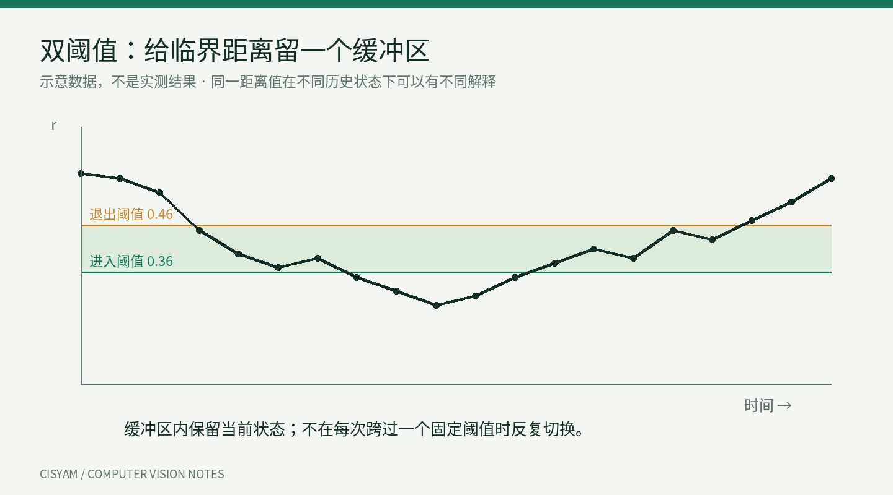
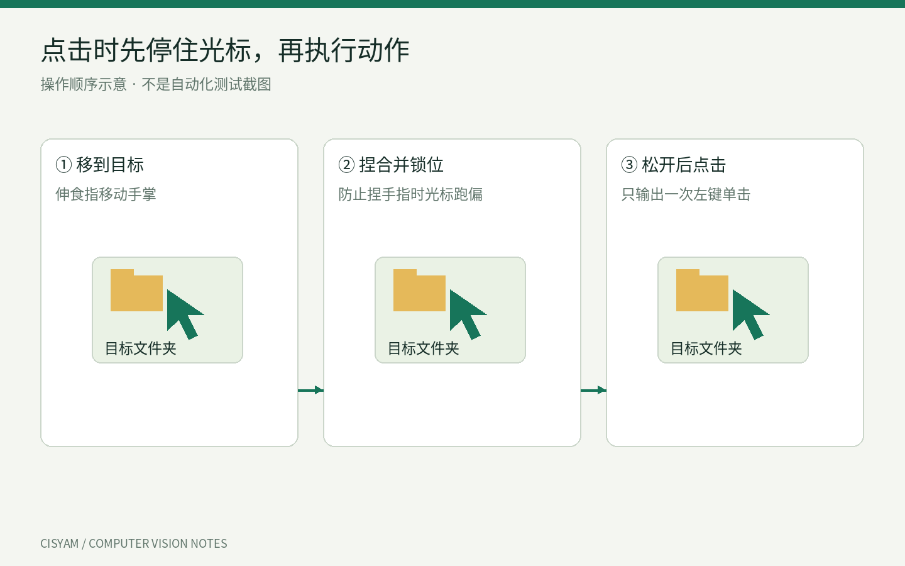
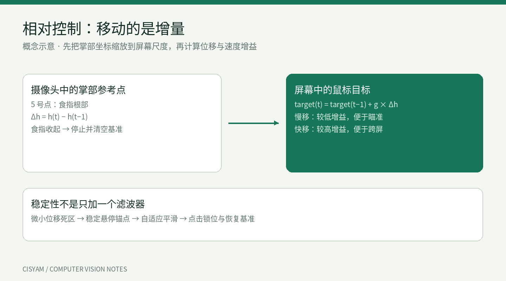
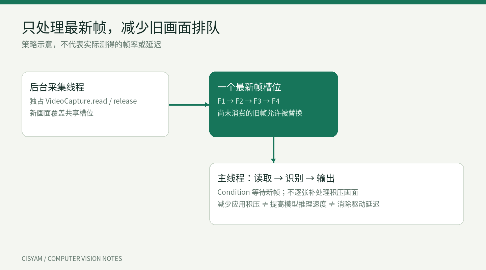

# 从识别手势到精准点击：OpenCV 手势鼠标的实现与优化

> 从“看见手”到“点中文件”，讲清手势鼠标的距离判断、点击状态机、防抖和延迟优化。

作者：cisyam555 · Python / OpenCV / MediaPipe · Linux X11



## 先说这个项目能做什么

不用拿鼠标，把手放在电脑摄像头前，伸出食指并移动手掌，屏幕上的光标就跟着移动。拇指与不同手指捏合再松开，可以单击、双击；小指长捏可以拖动窗口；双指轻推可以滚动网页。

这就是我做的手势鼠标。它使用普通摄像头，当前在 Linux X11 桌面运行，启动后先暂停，按 F8 才开始控制。F9 隐藏或显示预览，F10 退出。



刚开始，我以为“识别出手，再让鼠标跟着走”就够了。真正操作文件夹时，问题才出现：手没怎么动，光标却在漂；准备点击时，光标先跑开；捏住一次，有时会触发多次操作。网页不滚动时，也很难判断究竟是没识别到手势，还是鼠标事件没有作用到浏览器。

下面按这些问题展开，说明代码为什么这样写。文中的图是原理示意，数值例子用于解释思路，不是摄像头实测结果。

## 一、程序究竟是怎么“看懂手”的？

先分清工具各自做什么：

| 工具 | 通俗理解 | 项目中负责的事 |
| --- | --- | --- |
| OpenCV | 摄像头和画面处理工具 | 读取画面、镜像、转换颜色、显示预览 |
| MediaPipe | 手部位置检测工具 | 找出手上 21 个关键点 |
| NumPy | 计算工具 | 算坐标、指尖距离、掌宽比例 |
| PyAutoGUI | 电脑操作工具 | 移动鼠标、点击、按住、松开、滚轮 |

MediaPipe 不会直接告诉程序“用户想点左键”。它返回的是手腕、指尖、关节的位置。项目代码需要根据这些位置，自己定义什么算移动、什么算点击。



比如：4 号点在拇指指尖，8 号点在食指指尖。如果这两个点靠近，就可能是在做左击手势。但“靠近”还不够，我们还要知道它是不是主动捏合、持续了多久、有没有松开。

一帧图像的处理从这里开始：

```python
# 左右镜像，让画面方向更符合照镜子的习惯
frame = cv2.flip(frame, 1)

# OpenCV 默认是 BGR，模型输入需要 RGB
rgb_frame = cv2.cvtColor(frame, cv2.COLOR_BGR2RGB)

input_image = mp.Image(
    image_format=mp.ImageFormat.SRGB,
    data=rgb_frame,
)
result = detector.detect_for_video(input_image, timestamp)
```

`timestamp` 是递增的帧时间戳。模型在 VIDEO 模式下处理连续画面，结果中的手部关键点会交给后面的手势判断模块。

## 二、判断捏合：为什么要把距离除以掌宽？

假如规定“两个指尖小于 30 像素就算捏合”，手离摄像头远一点时，本来分开的手指也可能显得很近；靠近后，同样的动作又会显得更大。固定像素距离很容易受远近影响。

所以我用的是一个比例：

**捏合比例 = 两个指尖的距离 ÷ 画面中的掌宽。**



以左键为例：

```python
# 先把模型坐标转换成图像像素坐标
points = np.array([
    (p.x * width, p.y * height)
    for p in landmarks
])

# 5 和 17 号点之间的距离，作为掌宽参考
palm_width = float(np.linalg.norm(points[5] - points[17]))

# 4 是拇指尖，8 是食指尖
left_ratio = float(
    np.linalg.norm(points[4] - points[8]) / palm_width
)
```

`np.linalg.norm(a - b)` 在这里就是计算两点之间的直线距离。先转成像素坐标，是因为画面宽、高不同，不能直接把横纵方向的归一化坐标当成等比例长度。

掌宽归一化能减轻距离变化带来的影响，但侧掌、遮挡和透视仍然可能影响测量。实际代码还有关键点可见性检查，以及掌宽小于 20 像素时停止正常操作的保护；上面的片段省略了这些外围条件。

## 三、一次捏合，为什么不会一直点击？

摄像头连续拍到的每张画面叫一帧。举一个假设例子：如果每秒处理 20 帧，捏合保持半秒，程序可能连续 10 帧都判断“两个指尖很近”。如果每帧都点击，就会把一次手势变成很多次点击。

解决办法是让程序记住：这个动作现在进行到哪一步。这就是**状态机**。可以把它理解成一张操作流程单，必须按顺序走完，才输出一次点击。



当前普通单击和双击的主要过程是：

1. **张开准备：** 对应手指先与拇指分开，表示准备进行一次新动作。
2. **捏合确认：** 两个指尖足够靠近，并持续一小段时间。
3. **松开确认：** 两个指尖重新分开，并短暂保持。
4. **输出动作：** 发送一次点击，之后需要重新准备。

没确认就松开、多个主动捏合同时出现、必要指尖出画或动作超时，都可能取消本次操作。每根手指独立准备，可以减少自然蜷指造成的误触。

### 两个阈值分别管“捏住”和“松开”

阈值就是判断边界。当前代码使用：

```python
PINCH_ENTER = 0.36   # 小于这个掌宽比例，开始判断捏合
PINCH_EXIT = 0.46    # 大于这个掌宽比例，开始判断松开
READY_TIME = 0.06    # 张开准备时间，单位秒
MIN_HOLD = 0.04      # 普通捏合最小确认时间
RELEASE_TIME = 0.04  # 松开确认时间
COOLDOWN = 0.22      # 点击冷却时间
```

为什么不用同一个数字？想象距离在 0.40 附近来回抖动，如果 0.40 同时是进入和退出边界，程序就容易一会儿判捏住、一会儿判松开。

两个不同的边界中间留了一段缓冲区，这种设计叫**迟滞**。在缓冲区里，状态要参考前面已经发生的动作，而不是马上反转。各阶段的计时仍有各自条件。



这些时间不是硬件承诺。例如最小确认时间设为 0.04 秒，程序仍然要等实际采样帧到来才能确认，低帧率下可能多等一个或多个帧间隔。参数也不是所有人、所有摄像头下的最佳值。

## 四、明明对准文件了，为什么一捏手指就点偏？

因为捏合也是一种运动。手指靠近时，手掌和关键点可能一起变化。如果这个过程继续推动鼠标，光标就会先离开文件，然后才发生点击。

我的处理是：**点击过程中暂时锁住光标，确认松开后在原位置点击。**



手势控制器返回两个值：

```python
action, freeze = click_controller.update(...)
```

这里的 `...` 表示省略了各手指距离和可见性参数，不是直接复制运行的调用。`action` 告诉主程序需要哪种操作，`freeze` 告诉主程序此刻是否暂停移动。

为了减少准备捏合时的偏移，代码还有最多约 0.12 秒的预冻结；点击完成后，再保留约 0.14 秒的开指保护，然后重新建立移动基准。冷却与锁位目的不同：前者限制重复点击，后者减少光标跑偏。

双击也不用用户连续捏两次。无名指一次有效捏合后，程序调用：

```python
self.backend.doubleClick(interval=0.12, button="left")
```

拖拽则不同：小指捏合约 0.30 秒后就发送左键按下，随后允许移动，松开小指时释放左键。否则等松开才执行，就无法“按住拖动”。手丢失、暂停和退出也要释放按键，避免一直拖着目标。

## 五、手掌怎么控制鼠标？为什么收起食指就能停？

我早期使用“手在画面哪里，鼠标就去屏幕对应哪里”的方案，这叫**绝对映射**。它容易实现，但手指弯曲也会改变位置，而且手的活动范围受映射区域影响。

现在改成**相对移动**：只看这一次比上一次移动了多少。参考点选的是 5 号食指根部点，减少直接用指尖时弯指的影响。



可以用下面的关系理解，实际代码还包含缩放、增益和边界处理：

```text
手部位移 = 本次掌部位置 - 上次掌部位置
新鼠标目标 = 原鼠标目标 + 增益 × 手部位移
```

增益可以理解成放大倍数。小幅慢移时倍数低一些，便于瞄准；快速移动时倍数高一些，便于从屏幕一侧移到另一侧。

食指伸出是普通移动开关。收起食指时停止并清空移动基准，重新伸出后从当前光标位置继续。你可以像抬起实体鼠标重新摆放那样，把手移回舒服的位置，再继续操作。

### 手不动，光标还在漂怎么办？

关键点检测不会每帧都给出完全相同的坐标，手也很难绝对静止。因此代码做了几层处理：

| 处理 | 通俗解释 |
| --- | --- |
| 微小位移死区 | 特别小的变化先不输出，减少细碎抖动 |
| 自适应平滑 | 小误差慢跟随，大误差提高响应 |
| 悬停锚点 | 稳定约 0.45 秒后记住停住位置，明显移开再恢复 |
| 重建基准 | 点击、收指等状态结束后，避免直接接上旧坐标 |

平滑的核心形式是：

```python
alpha = 1 - math.exp(-2 * math.pi * cutoff * dt)
new_x = old_x + (target_x - old_x) * alpha
```

可以先把它理解成“每次向目标靠近一部分”。`alpha` 决定靠近多少，`dt` 是两次更新之间的时间间隔，`cutoff` 用于调节响应速度。实际代码会随误差调整响应，而不是所有情况都用同一个固定系数。

平滑越强，也可能越拖沓；死区越大，也可能吞掉用户想做的小动作。这里需要在停稳和跟手之间调节，单纯把某个阈值加大并不能解决所有问题。

## 六、为什么有时只看到鼠标动，网页却不滚？

先区分两种情况：**没有进入滚动**，以及**输出了滚轮但网页没响应**。

| 画面或现象 | 可能卡在哪里 | 怎么检查 |
| --- | --- | --- |
| `SCROLL` 提示手指未伸出 | 姿势条件未满足 | 看具体提示，调整食指和中指 |
| 正在 `PINCH` 或 `DRAGGING` | 点击或拖拽占用输入 | 先完成或松开，再进入滚动 |
| `UP/DOWN` 都不增加 | 没选定方向或没进入滚动 | 双指保持片刻后，向下轻推试一次 |
| `DOWN` 增加，页面不动 | 输出已发送，目标区域可能不对 | 把指针放正文，确认网页没有到底 |

项目的滚动方式是：食指和中指伸出，无名指、小指自然弯曲，保持约 0.16 秒后进入；向上或向下轻推约 0.10 掌宽，就选定滚动方向；保持姿势持续滚，收起中指停止。默认目标速度是每秒 6 格，实际频率还受处理速度影响。

另一处难点是动作可能重叠：无名指双击时，食指和中指也可能伸着，看起来像滚动。因此程序先检查主动捏合，再判断是否允许滚动；拖拽进行中则保持拖拽。**输入互斥**就是明确这一刻由哪一种操作接管，避免同时点击、移动和滚动。

## 七、隐藏摄像头窗口了，为什么还会卡？

隐藏窗口主要减少画面绘制，但采集和识别还在运行。如果主要耗时来自摄像头或模型，仅减少文字和骨架绘制，改善可能有限。

另一个常见问题是旧画面排队。可以把采集和处理想成“摄像头不断送来照片，模型一张张看”。送得比看得快，后面就会越积越多，屏幕上的鼠标一直在响应过去的动作。

我的方案是让后台线程持续采集，只保留最新一张。模型处理完上一张后，直接看当前最新的画面。



代码里用 `threading.Condition` 协调两个线程，可以理解成“有新画面时通知处理线程”。采集线程负责读取和释放摄像头，主线程负责识别和控制，避免一个线程读画面的同时另一个线程强行释放设备。

这样减少的是应用排队等待，不会直接提高模型推理速度，也不能消除摄像头曝光、USB 传输和驱动缓存带来的时间。它适合关心当前动作的交互系统，不适合要求每一帧都保留的录像任务。

| 性能字段 | 应该怎么理解 |
| --- | --- |
| `Camera` | 摄像头实际采集速度，每秒多少帧 |
| `FPS` | 主循环实际处理速度 |
| `detect` | 图像转换与模型识别阶段的耗时 |
| `ui` | 预览绘制等界面阶段的耗时 |
| `app wait` | 画面到达应用后等待处理的时间，不是完整响应延迟 |

## 八、怎样证明功能真的实现了？

看到识别提示只是第一步，还需要看目标软件是否完成了操作。输出计数增加，表示程序调用了鼠标接口，不代表浏览器一定滚动或文件夹一定打开。

实际验收可以准备一个文件夹、一个普通窗口和一个长网页，按顺序验证：

1. 移到文件上，停住，再左击选中。
2. 右击弹出菜单，关闭菜单后双击打开文件夹。
3. 小指长捏拖动窗口，松开放下。
4. 指针放网页正文，双指向下滚、停止、向上滚。
5. 拖动过程中把手移出画面，确认左键释放。
6. 按 F8 暂停、F9 隐藏和恢复预览、F10 退出。

如果要量化效果，可以固定目标大小、光照和摄像头位置，每种操作重复 20 次，记录成功次数；普通移动一段时间，再统计误触。当前没有统一条件下的准确率与完整延迟报告，不能把一次演示成功写成“准确率 99%”。

## 写在最后

这个项目从基础移动和左右键，逐步补到了双击、拖拽、滚动和状态保护。对我来说，最大的收获是理解了视觉交互中的三个问题：怎么判断动作完成了，怎么让光标停稳，以及怎么避免程序处理过时的信息。

它目前更适合短时间非接触操作和技术演示，仍受光照、遮挡、手部朝向和摄像头性能影响，长时间举手也容易疲劳。后续我更希望把它用于具体场景，例如免接触查看操作手册，再评估成功率、误触和舒适度。

**项目源码：** [cisyam555/opencv-gesture-mouse](https://github.com/cisyam555/opencv-gesture-mouse)

想看代码，可以按 `main.py → app.py → control/gestures.py → control/pointer.py → control/scroll.py → camera.py` 阅读。这些模块位于 `opencv/gesture_mouse/` 下，入口 `main.py` 位于 `opencv/`。

*本文使用 MediaPipe 预训练模型，没有自行训练手部识别网络。代码片段用于解释核心逻辑，省略部分外围判断；配图均为说明原理的示意图。*
