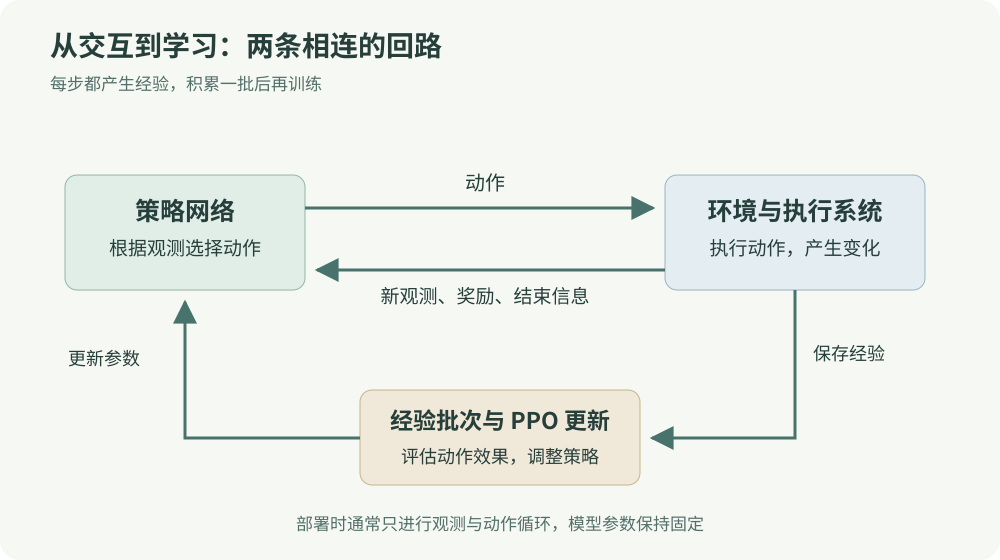

# 强化学习入门：机器人如何通过试错学会完成任务？

学习 ROS 时，我更习惯这样的工作方式：读取传感器数据，根据任务编写逻辑，再把速度或关节目标发给控制器。接触强化学习后，一个问题变得很具体：如果不逐条写出“什么时候前进、什么时候出拳”，机器人能不能从尝试的结果中学会决策？

这篇文章以 ROS 初学者的视角，整理强化学习的基本流程，并借助机器人打拳和小车到达目标点的例子，理解奖励、PPO 和控制接口之间的关系。文中的配置与场景用于说明原理，不作为本文的实测结果。

## 一、强化学习到底在学习什么？

先想象一个简单任务：让仿真小车到达目标点，同时尽量避免碰撞。

我们可以手写控制规则，也可以让小车反复尝试。每次尝试时，小车接收观测、选择动作、看到执行结果，再获得一个奖励。训练算法利用这些经验调整决策方式。

这里需要认识五个概念：

| 概念 | 在小车任务中的含义 |
| --- | --- |
| 智能体 | 做决策的小车控制系统 |
| 环境 | 小车、障碍物、目标及它们的运动和交互规则 |
| 观测 | 激光雷达信息、目标相对位置、自身速度等 |
| 动作 | 例如线速度和角速度指令 |
| 奖励 | 根据接近目标、到达目标或发生碰撞计算的反馈 |

智能体学习的核心是**策略**：在当前观测下，应该怎样选择动作。用一句简化的表达就是：

> 策略根据观测生成动作，训练算法根据经验改进策略。

训练通常希望提高一段时间内的期望累计回报，而不只是让下一步得分最高。实际算法常使用折扣因子，让不同时间的奖励以不同权重参与计算。

环境的完整状态与策略能获得的观测需要区分。例如，仿真器可能知道所有障碍物的位置，但机器人只能通过雷达看见其中一部分。设计策略时，必须明确它实际能获得什么信息。

## 二、一次交互和一次学习，是两件事

强化学习的交互过程可以按时间顺序理解：

1. 环境返回当前观测。
2. 策略根据观测生成动作。
3. 环境执行动作，推进机器人与周围世界的变化。
4. 环境返回下一次观测、奖励以及结束信息。
5. 将这次交互保存为经验，继续采集或进入训练更新。

不过，**获得一次奖励，不等于立刻修改一次网络参数**。很多算法会先积累一批数据，再执行多次梯度更新。

这与 ROS 中的周期控制也有联系。物理仿真推进频率、策略决策频率和参数更新频率，描述的是不同过程。例如控制器可能在两个策略决策之间执行多次控制计算，策略也可能收集很多步经验后才训练。

因此，看到“训练了多少步”时，要继续确认：这是单个环境的步数，还是所有环境合计的交互数量？每个决策步又对应多少仿真时间？单看步数，无法直接换算成训练耗时或控制频率。

## 三、从 ROS 看策略网络：输入和输出必须说清楚

在 ROS 项目中，消息类型匹配还不够，单位、时间戳和坐标系同样重要。强化学习的输入输出也需要这样的严谨性。

### 1. 输入：模型看到了什么？

打拳案例中的策略输入有 1097 个数，包括关节位置、速度、相对位置和历史动作等信息。这个维度属于具体项目，并非强化学习的固定要求。

如果换成小车任务，我们需要根据任务决定观测内容。例如目标在车体坐标系中的位置，能让策略知道应该往哪里走；当前速度则能帮助策略判断惯性和运动趋势。

输入还需要注意数值尺度、传感器延迟和数据可获得性。仿真中能直接读取的真值，到了实机上可能需要定位或感知模块估计。训练时与部署时的观测含义应当保持一致。

### 2. 输出：模型能控制什么？

打拳案例中的策略输出是 225 维目标位姿信息，由 5 个目标点、未来 5 个时刻和每个目标位姿的 9 维表示组成，再交给已有下控执行。

这提醒我，不能把“网络输出了动作”简单理解成“网络直接控制所有电机”。不同系统的动作可能是速度、关节目标、末端目标，也可能是某个已有控制目标上的残差。

在实际项目中，至少应该明确：

- 输出表示绝对目标，还是相对当前状态的增量？
- 位置与姿态使用什么单位、坐标系和表示方法？
- 输出如何缩放、限幅，再交给哪个控制器？
- 策略决策频率与底层控制频率如何配合？

对小车来说，策略动作经过转换后可以形成速度指令，再交给运动控制器；但具体是否使用 `/cmd_vel`、使用哪种消息和接口，都取决于机器人系统。强化学习本身不要求必须使用 ROS。

## 四、奖励为什么重要：模型会认真优化你给它的分数

机器人不会自动知道“勇敢进攻”或者“走得漂亮”意味着什么。它接收的是训练中定义的奖励信号。

奖励可以分成几种容易理解的形式：击中时给事件奖励，接近合适距离时给过程奖励，摔倒时给惩罚。这些设计试图让机器人既接近任务目标，又避免不希望发生的行为。

问题在于，多个奖励放在一起，可能产生意外结果。

例如，假设机器人站着也能持续获得姿态风格奖励，而主动靠近对手意味着挨打或摔倒。那么在当前奖励结构和经验条件下，“不动”可能比“尝试进攻”更划算。

**奖励只是我们表达目标的方式，能否准确表达，需要通过实验检查。**

不同奖励项的权重也不能只按数字大小比较。一次触发的大额奖励，与每一步持续累计的小额奖励，最终贡献可能完全不同。原始取值范围、触发频率和回合长度都需要考虑。

对于小车到达目标的说明性例子，可以考虑目标进展、到达奖励、碰撞惩罚和时间成本，但这些只是设计起点，具体组合仍需验证。过程奖励过强，可能让策略反复获得局部分数；安全惩罚过重，也可能让它倾向于停止行动。

评估时，除了总回报，还应单独看任务成功率、碰撞率、完成时间等指标，并记录各项奖励的累计贡献。

## 五、PPO 怎样把经验变成策略改进？

以打拳为例，训练数据会记录机器人当时看到了什么、选择了什么动作，以及后续得到了怎样的结果。PPO 利用这些数据更新策略。

这里先抓住两个概念。

### 1. 优势：结果比原本预期好多少？

“这次得了正奖励”还不足以说明动作特别好。算法还需要比较：在这个状态下，原本预期能取得什么结果？

优势估计用于表达这种差异。PPO 通常借助价值函数和时间序列中的奖励进行估计。优势为正时，策略目标倾向于提高对应动作的概率；优势为负时，倾向于降低其概率。

这种判断考虑后续收益，所以一个暂时没有得分、但有利于之后击中的移动，也可能获得正的优势估计。估计本身并不完美，其质量会影响学习效果。

### 2. 裁剪：抑制某些过大的策略变化

PPO 会比较新旧策略对采样动作给出的概率。为了避免对同一批数据优化时变化过猛，它在策略目标中使用裁剪机制。

常见的 `clip = 0.2` 配置 可以帮助理解这个尺度，但需要注意：**它不是“网络参数最多改变 20%”，也不保证所有新旧动作概率比都严格落在 0.8 到 1.2 之间。**

裁剪改变的是训练目标在特定情况下对进一步更新的激励。训练是否稳定，还受学习率、优势估计、动作分布以及其他损失项等因素影响。

此外，PPO 的这种更新通常不需要对物理仿真器求导。它利用采样经验和策略的概率信息更新网络。因此，“环境不可微”和“策略学不到有效行为”不能直接画等号。

## 六、4096 个环境同时运行，究竟在并行什么？

以这样一组并行训练配置为例：

| 配置 | 数值 |
| --- | --- |
| 并行环境数量 | 4096 |
| 每个环境采集步数 | 24 |
| 一批采集的转换数据数量 | 4096 × 24 = 98,304 |
| 训练轮数 | 5 |
| 每轮小批数量 | 4 |

可以把它理解成许多仿真实例使用同一组策略参数，同时收集不同经历。采集完成后，每轮把数据分成 4 个小批，共训练 5 轮。在普通前馈配置、没有额外梯度累积等机制的情况下，对应 20 次小批优化步骤。

这几个数字是案例配置，不代表任何任务都应该照搬。并行环境有助于增加采样吞吐，但效果取决于计算资源、环境多样性和算法设置。起点、对手或扰动过于相似，仍可能产生大量重复经验。

同一批数据重复训练能提高利用率，但训练过多会让当前策略进一步偏离采集数据时的策略。PPO 因而需要控制更新幅度，并在后续继续采集新数据。

## 七、机器人不动时，先验证它到底能不能被这样控制

排查训练问题时，有一点需要特别注意：发现机器人不动，不能立刻认定是 PPO 不行，或者只需要提高学习率。

如果动作接口本身没有提供预期的控制能力，继续修改奖励可能仍然无效。一个更容易操作的排查顺序是：

| 检查顺序 | 要回答的问题 |
| --- | --- |
| 手动输入动作 | 给一个已知、有限幅的测试动作，机器人能否按预期响应？ |
| 动作传递过程 | 网络输出经过缩放、转换、限幅后，实际送给下控的是什么？ |
| 控制权限 | 策略能影响走路、手臂还是目标残差？下控内部已经完成了哪些功能？ |
| 观测与反馈 | 数据是否过期，坐标系是否一致，动作后能否观察到相应变化？ |
| 奖励与训练 | 不动和主动行动分别获得多少回报，探索与更新是否正常？ |

可以通过零动作、固定动作和闭环策略等对照，检查运动到底由哪一层产生。不过，轨迹相似本身还不是完整证明，也需要进一步检查动作干预幅度、限幅以及下控响应。

对 ROS 学习者而言，这与调试“节点在发布，机器人却没有正确运动”的问题很相似：需要沿着数据和命令逐段验证，而不是只看最终现象。

## 八、我的入门实践应该从哪里开始？

相比直接复现高维人形机器人任务，我更适合先做一个能解释清楚每项观测、每个动作和每条奖励的小任务，例如仿真中的小车到达目标点。

第一阶段先手动控制，确认机器人模型、坐标系与执行接口正常。第二阶段实现环境接口，验证复位、步进、奖励和结束条件。第三阶段接入现成算法，在固定评测条件下观察成功率与行为变化。最后再逐步增加障碍物、初始位置变化和传感器噪声。

训练阶段通常会更新网络参数；部署阶段则加载训练好的策略，根据新观测生成动作。机器人持续观察并行动，并不等于它在运行时持续学习。若要在线更新，还需要单独设计和验证训练机制。

这次学习让我更明确：强化学习项目首先要把任务、观测、动作和控制权限说清楚，然后才是奖励与算法调试。能解释每个输入从哪里来、每个输出让机器人做什么，是开始训练前很实际的一步。

## 参考资料

- [Proximal Policy Optimization Algorithms](https://arxiv.org/abs/1707.06347)：PPO 原始论文。
- [Gymnasium：Basic Usage](https://gymnasium.farama.org/introduction/basic_usage/)：环境交互接口与基本使用方式，实际开发应注意终止与时间截断的区别。
- [Stable-Baselines3：PPO](https://stable-baselines3.readthedocs.io/en/master/modules/ppo.html)：PPO 实现、配置与使用说明。
