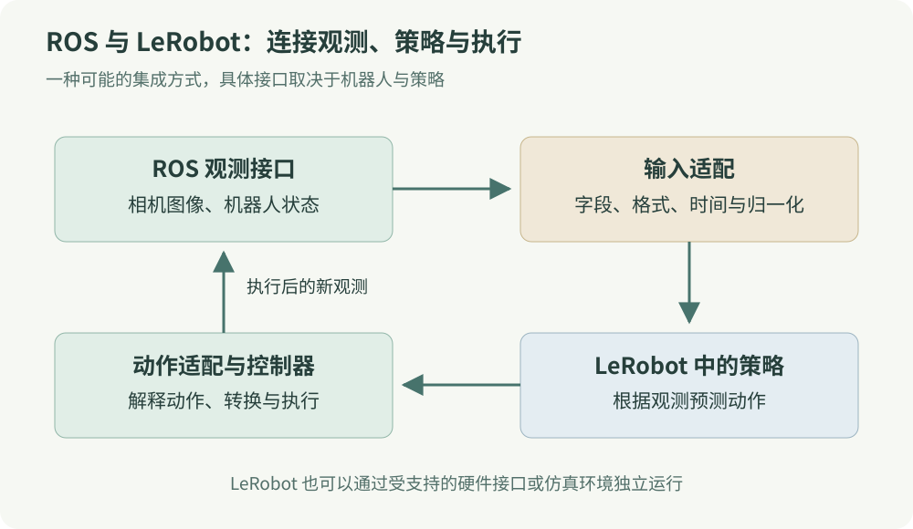

# 学过 ROS，再看 LeRobot：机器人学习框架到底解决什么问题？

学习 ROS 时，我们通常从节点、话题、服务和动作开始，逐渐接触相机、机械臂、坐标变换、运动规划和控制器。通过这些工具，可以把不同设备和功能模块连接起来，组织成一个机器人系统。

接触 LeRobot 后，一个问题很容易出现：它也能连接相机和机器人，也能执行动作，为什么还需要另一套框架？它和 ROS 有什么关系？

理解这个问题，可以从一个具体任务开始：**让机械臂把桌上的罐头放进篮子。**

## 一、使用 ROS，怎样完成一次抓取？

一种常见的实现方式，是把任务拆成多个模块。

首先，相机获取桌面图像。感知模块识别罐头与篮子，估计它们的位置。接着，任务程序安排抓取、移动和放置等步骤，运动规划模块计算可执行的路径，控制器驱动机械臂和夹爪完成操作。

执行过程中，系统继续读取关节状态和传感器数据，检查动作是否完成。如果抓取失败，还可能需要重新观察、调整位置并重试。

在这套流程中，各模块需要交换信息。例如：

- 相机驱动发布图像。
- 感知模块输出目标位姿。
- 坐标变换系统将目标位置转换到机械臂使用的参考系。
- 规划模块生成运动轨迹。
- 控制器接收目标并反馈执行状态。

ROS 提供了通信、设备接入、坐标变换、运行管理和调试等基础能力。借助其生态中的工具，还可以实现运动规划、导航与控制。

不过，**模块能够通信，并不意味着系统已经知道怎样完成任务。**开发者仍需要决定使用哪些模块，以及怎样组织任务逻辑。

例如，“夹爪没有抓到罐头时怎么办”“罐头位置发生变化后是否重新规划”，都需要具体的实现。

## 二、如果希望机器人从示范中学习呢？

假设我们希望先由人操作机械臂，演示怎样抓起罐头，再让模型学习根据画面和机器人状态选择动作。

这时，项目中会增加一整套围绕数据与模型的工作。

### 1. 采集示范数据

机器人需要记录操作过程中发生了什么。

一条示范轨迹可能包含：

| 数据 | 表达的内容 |
| --- | --- |
| 相机图像 | 当时看到了什么 |
| 机器人状态 | 关节位置、夹爪状态等 |
| 任务描述 | 希望完成什么任务 |
| 操作动作 | 当时下发了什么控制目标 |
| 时间信息 | 各项记录对应哪个时刻 |

只有一段操作视频，通常不足以直接训练带动作监督的策略。模型还需要知道：**在这个观察条件下，示范者采取了什么动作。**

这些数据也要正确对应。如果图像记录的是抓取前的场景，动作标签却来自抓取后的时刻，就可能给训练带来错误信息。

### 2. 整理和检查数据

采集完成后，还要确认数据能否用于学习。

例如，两次采集使用的关节顺序是否一致？动作记录的是绝对目标还是相对增量？夹爪数值表示张开程度，还是开合命令？是否存在丢帧和时间不同步？

这些问题直接影响模型学到什么。

### 3. 训练和执行策略

整理好的示范可以用于训练或微调策略。策略学习的是：在某种观测和任务条件下，应该生成什么动作。

训练完成后，还需要加载模型、处理实时观测、调用推理接口，并把模型输出转换为机器人能够执行的命令。

最后，要通过实际任务评估效果，而不能只看训练损失是否下降。

**LeRobot 主要围绕这条机器人学习流程提供工具。**

## 三、LeRobot 解决什么问题？

LeRobot 是 Hugging Face 推动的开源机器人学习框架。它包含数据工具、策略实现、训练与评估代码，以及部分机器人和相机的接入能力。

可以把它理解成一个围绕机器人学习组织的开发工具箱。

| 环节 | 常见需求 | LeRobot 提供的相关能力 |
| --- | --- | --- |
| 设备接入 | 连接机器人、相机和遥操作设备 | 受支持的硬件接口与配置 |
| 示范采集 | 同步记录观察和动作 | 遥操作与数据记录工具 |
| 数据管理 | 读取、组织和检查轨迹 | 数据格式、加载与可视化工具 |
| 策略训练 | 从数据中训练或微调模型 | 策略实现、训练流程与配置 |
| 策略执行 | 加载模型并生成动作 | 推理接口及相关处理流程 |
| 效果评估 | 检查任务完成情况 | 与受支持环境配套的评估工具 |

具体支持哪些硬件、策略和环境，需要查看所使用版本的文档。框架提供了共同的流程，并不意味着任意机器人和任意模型都能直接组合运行。

这里还要分清 **LeRobot 和 SmolVLA**：

LeRobot 是框架；SmolVLA 是一种具体的机器人策略模型。LeRobot 可以用于加载、训练或执行相应策略，模型则负责根据输入条件预测动作。

类似地，下载预训练权重并运行推理，与自己采集数据、训练模型，是不同阶段的工作。

## 四、ROS 与 LeRobot 的分工有什么不同？

两者都涉及机器人软件，但关注重点不同。

ROS 面向机器人系统的组织与协作，LeRobot 更关注机器人学习的开发流程。它们也存在功能交集，例如设备接入、数据记录和动作执行。

| 比较角度 | ROS | LeRobot |
| --- | --- | --- |
| 主要关注 | 机器人系统中各模块的通信与协作 | 数据采集、策略训练、评估与执行 |
| 常见概念 | 节点、话题、服务、动作、坐标系 | 轨迹、数据集、策略、训练配置、推理 |
| 决策方式 | 可以接入规则、规划器或学习策略 | 提供多种学习策略及相关工具 |
| 硬件连接 | 通过驱动和相关接口接入设备 | 为部分硬件提供直接支持 |
| 是否必须搭配使用 | 可以独立构建机器人系统 | 可以通过自身接口或仿真环境运行 |

因此，不宜简单理解成“ROS 负责执行，LeRobot 负责训练”。ROS 系统中可以运行训练和推理程序，LeRobot 也可以直接连接部分硬件执行策略。

**判断分工时，应当看项目中每个组件实际承担什么职责。**

## 五、两者怎样在一个项目中配合？

对于已经使用 ROS 的机器人，可以考虑让原有系统继续负责传感器与硬件控制，再接入学习策略。

以机械臂抓取为例，一种可能的数据流是：

1. ROS 获取相机图像和机器人状态。
2. 适配程序将数据整理为策略需要的观测。
3. 调用 LeRobot 中的策略生成动作。
4. 适配程序解释并转换动作。
5. 通过机器人控制接口执行。
6. 读取新的观测，继续决策。

这里的“适配程序”很重要。ROS 消息与模型输入之间，通常不会天然一一对应。

### 输入适配：数据不仅要有，还要含义正确

模型可能需要外部相机、腕部相机以及一组机器人状态。

接入时需要确认：

- 两路相机是否对应正确。
- 图像尺寸、颜色顺序和数值范围是否符合要求。
- 机器人状态中的关节排列与训练配置是否一致。
- 不同数据的时间是否足够接近。
- 是否使用了模型要求的归一化与预处理。

例如，把外部相机与腕部相机的输入交换，程序可能仍能运行，但输入含义已经改变。

### 输出适配：预测动作还要经过解释

策略可能输出关节目标、末端位姿、速度，或者相对当前状态的增量。

不同输出需要不同的执行方式。

如果模型输出末端目标，而机器人接口接收关节目标，就需要必要的运动转换。如果模型输出关节位置，则要确认关节顺序、单位和限位。

还需要弄清楚：模型预测的是一步动作，还是一段动作？一次执行多少步？什么时候根据新观测重新预测？

这些问题决定了系统怎样应对环境变化。

### 执行约束：学习策略仍需控制系统配合

模型生成的目标最终要交给控制器执行。运动范围、速度限制、异常停止和状态反馈等机制仍然需要明确。

机器人动作不正确时，应当沿着输入、推理、动作转换和执行接口逐段检查。模型能够正常加载，只能说明其中一个环节完成了。

## 六、使用 LeRobot，必须先搭建 ROS 吗？

不必须。

如果机器人已经被 LeRobot 的硬件接口支持，就可能通过相应接口直接完成遥操作、采集和策略执行。

在仿真中，也可以直接调用环境接口。例如，策略读取仿真观测，生成动作，再通过环境的 `step()` 方法推进执行。这条流程可以不经过 ROS。

是否引入 ROS，取决于系统需求。

如果项目已经有 ROS 驱动、控制器、感知和其他功能模块，接入 ROS 可能方便复用现有系统。如果只是验证一个受支持机器人上的学习任务，直接使用 LeRobot 的流程可能更简单。

选择工具时，应该先明确任务与已有条件，再决定怎样组合。

## 七、学过 ROS，再学 LeRobot，可以从哪里入手？

对于有一定 ROS 基础的学习者，可以先沿着输入输出理解项目，再逐渐深入模型训练。

### 第一阶段：看懂策略如何执行

先加载一个已有策略，确认以下问题：

- 输入来自哪些相机和状态数据？
- 数据经过什么预处理？
- 策略输出的动作有什么物理含义？
- 动作怎样交给环境或硬件？
- 系统多久读取一次观测、多久重新预测？

这个阶段的目标是解释清楚一次动作怎样产生并执行。

### 第二阶段：看懂一条示范轨迹

打开数据集，观察图像、状态和动作的对应关系。

尝试回答：这一帧画面下，示范者下发了什么命令？这个命令与机器人实际测得的状态有什么区别？不同时间的数据是否正确对齐？

理解这些内容后，才能更准确地理解模型在学习什么。

### 第三阶段：尝试小规模微调与评估

选择任务明确、接口可控的场景，采集少量高质量示范，进行微调，并在固定条件下测试。

除了训练损失，还要观察任务成功率和失败类型。一次抓取成功，能够证明系统在某次条件下完成了任务；稳定性与泛化能力，则需要更多回合和不同条件下的评估。

## 八、从“连接模块”到“连接经验与动作”

ROS 基础能够帮助我们理解传感器、坐标系、通信和控制链路。接触 LeRobot 后，需要进一步理解经验如何被记录成数据，数据如何用于训练策略，以及策略如何接回机器人执行系统。

在机械臂抓取任务中，模型、框架与控制器各有职责。真正运行起来，需要把观测、决策、动作和反馈连接完整。

对初学者来说，一个实际的学习目标是：**能够说清楚每个输入从哪里来、模型输出代表什么，以及机器人为什么会执行这个动作。**有了这层理解，再去学习策略结构和训练方法，会更容易把算法与机器人联系起来。

## 参考资料

- [ROS 2 官方文档](https://docs.ros.org/en/rolling/)：通信机制、开发工具与机器人系统基础。
- [LeRobot 官方文档](https://huggingface.co/docs/lerobot/index)：硬件、数据集、策略和训练执行流程。
- [LeRobot GitHub 仓库](https://github.com/huggingface/lerobot)：框架源码、示例与版本信息。
- [ros2_control 官方文档](https://control.ros.org/)：ROS 2 中的硬件接口与控制器框架。
