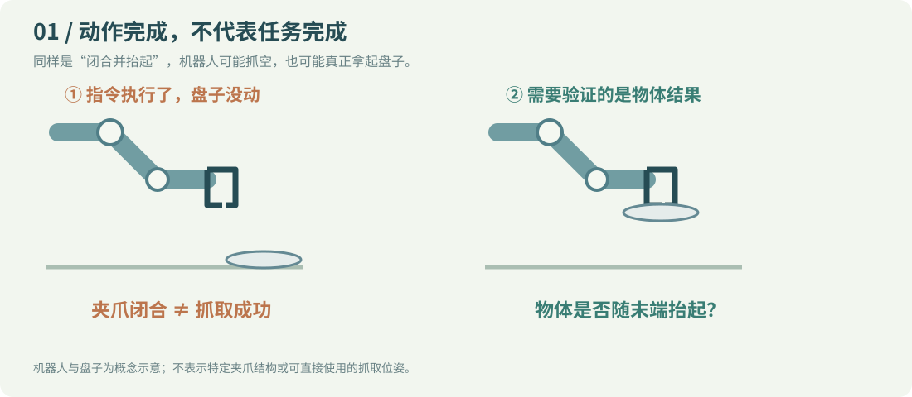
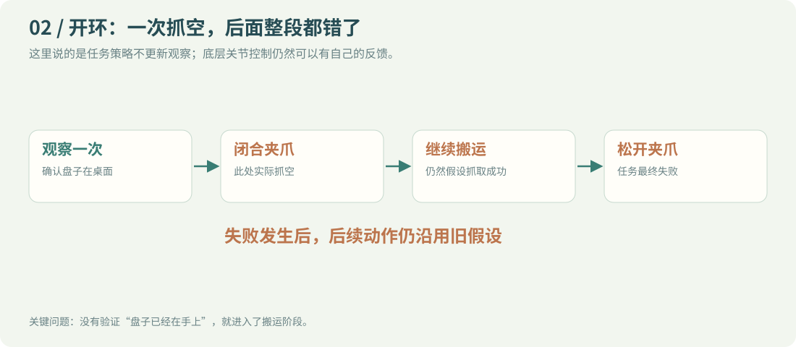
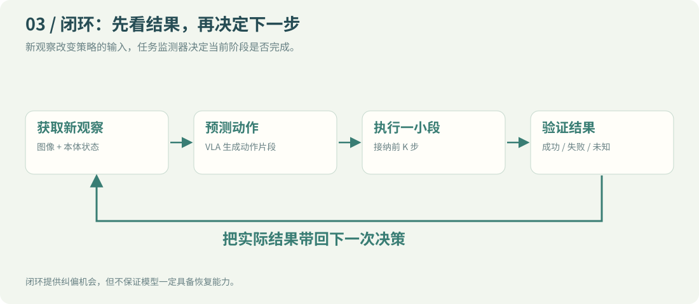
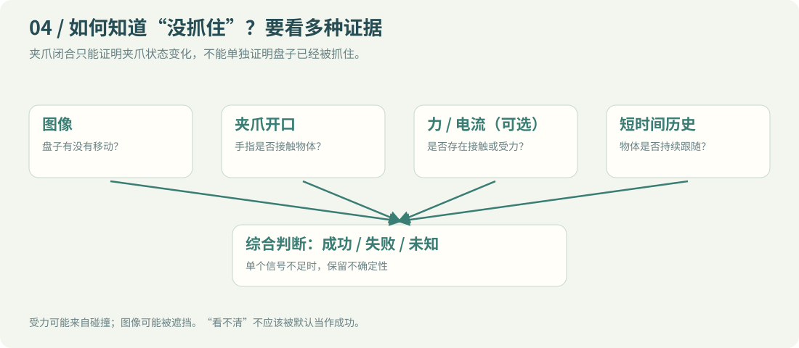
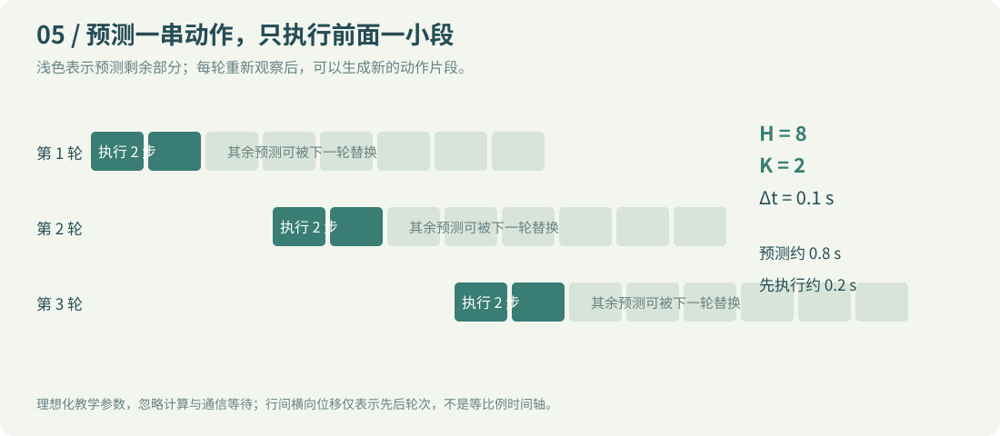
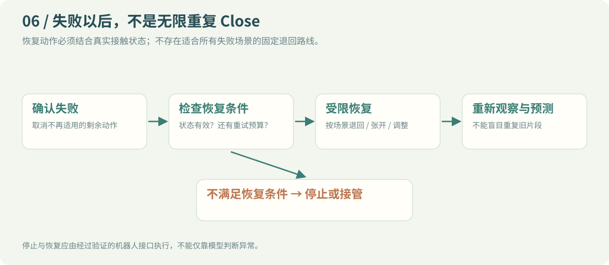
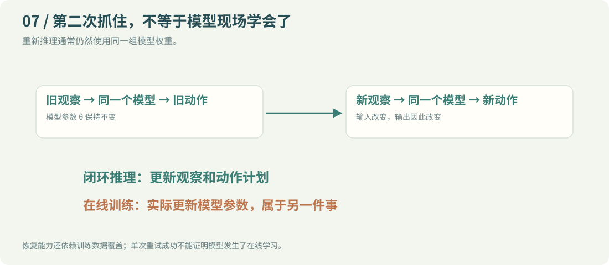

# 机器人没抓住盘子之后：VLA 如何通过闭环反馈调整动作？

你说“把盘子放进水槽”，机械臂闭合夹爪、抬起、移动——但盘子还留在桌上。**接下来怎么办？** 用 7 张图，讲清 VLA 系统的闭环反馈。

## 1. 先分清：动了，不等于做成了

夹爪收到 Close 命令，不能证明已经抓住盘子。系统需要验证的是**动作产生的物理结果**，而不只是命令有没有执行。

## 2. 不检查结果，错误就会一路传下去

长序列如果持续依赖“已经抓住”的旧假设，就可能把空夹爪一直搬到水槽。问题出在任务状态没有及时更新。

## 3. 闭环：让新观察影响下一步

策略可简写为 `Aₜ ~ πθ(· | oₜ, sₜ, ℓ)`：根据图像、本体状态和指令预测动作。闭环执行把**新观察**送回策略，并用任务监测判断是否继续。

VLA 不必独自承担全部判断；结果验证、控制约束和停止机制可以由独立模块实现。

## 4. 发现失败，需要证据，而不是猜测

图像可能被遮挡，电流变化可能来自碰撞。应结合可用信号和短时间历史判断；证据不足时保留“未知”，等待有效观察或停止，而不是直接进入搬运。

## 5. Action Chunk：预测多步，不必全部执行

`H` 是预测步数，`K` 是本轮执行步数，`Δt` 是每步间隔。图中只执行前两步，再接入新反馈。**K 更小不一定更好**：模型返回太慢，动作仍然会依据旧画面。

部署还需要记录观察时间戳和执行进度，明确新旧片段怎样交接，避免重复执行过期的相对位移。示例数字不是性能实测。

## 6. 抓空之后：有限恢复，再重新判断

盘子可能移位，夹爪也可能仍然闭合，所以不能直接重放原动作。恢复要依据当前状态，并设定重试与超时边界；传感器失效或控制器故障，也不能靠多调用一次模型解决。

## 7. 重新预测，不等于在线学习

闭环推理通常保持模型参数 `θ` 不变，改变的是观察、任务状态和动作计划。如果训练数据没有覆盖失败后的状态，模型也可能不知道怎样恢复。

## 一句话总结

**闭环反馈，就是让机器人根据“实际发生了什么”决定下一步，而不是一直假设“上一步已经成功”。** VLA 生成动作，任务监测验证结果，执行系统处理交接和有限恢复，三者需要配合。

## 来源与阅读

- [OpenVLA](https://arxiv.org/abs/2406.09246)：VLA 模型与机器人动作预测背景。
- [ACT：Learning Fine-Grained Bimanual Manipulation with Low-Cost Hardware](https://arxiv.org/abs/2304.13705)：动作片段相关背景。ACT 本身不是 VLA，本文前缀执行图也不是其时序集成算法的复现。
- [DAgger 论文](https://arxiv.org/abs/1011.0686)：模仿学习的执行分布偏移背景。
