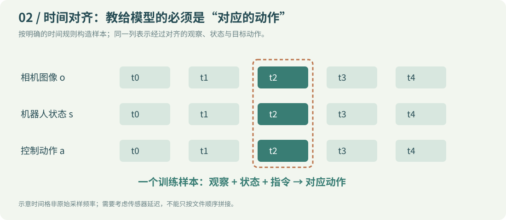
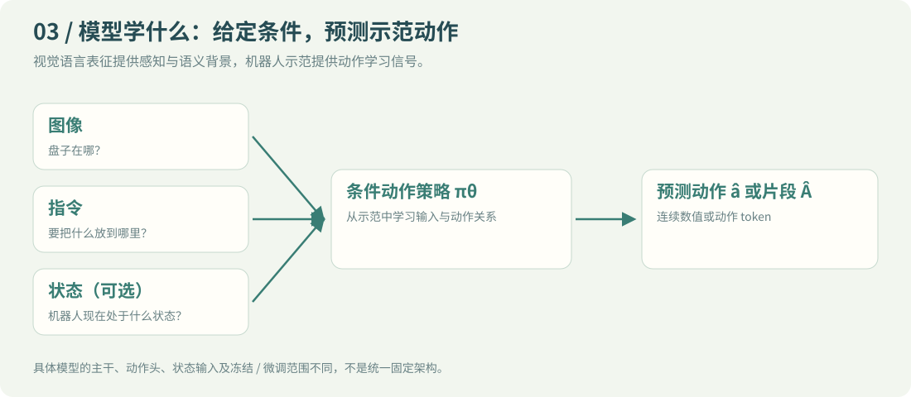
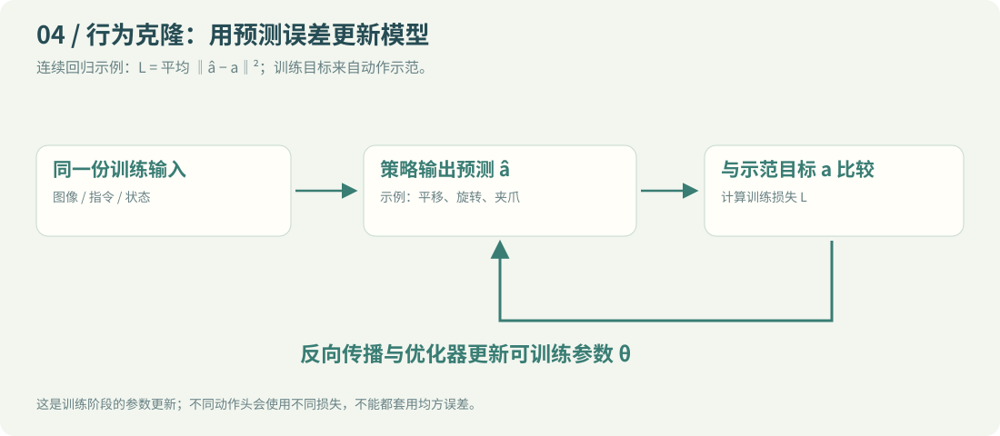
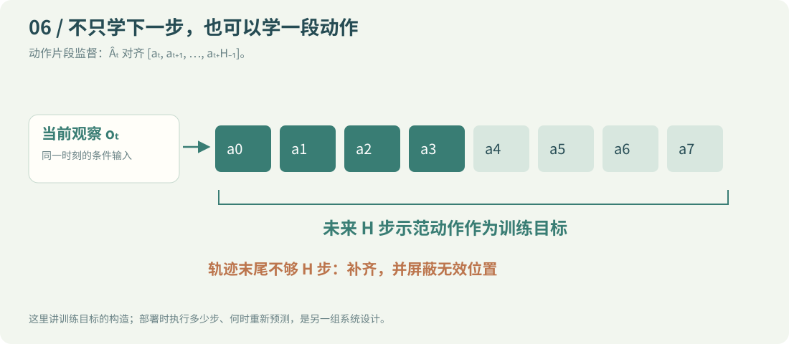
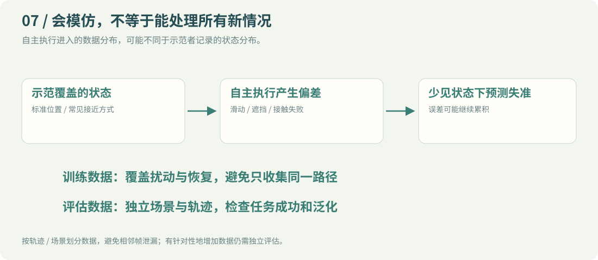

# 从人类示范到机器人策略：VLA 如何学习动作？

人操作机械臂拿起盘子，机器人记录过程。之后，模型怎样从这些记录里学会“看到什么、听到什么指令，就做什么动作”？用 7 张图拆开这条学习链路。

## 1. 示范：教的不是视频，是观察与动作的对应关系

人可以通过遥操作等方式完成任务，同时记录图像、指令、机器人状态和控制动作。**只有视频，通常不足以直接训练这种带动作标签的策略**；还需要知道机器人当时执行了什么，以及这些动作的单位和坐标系。

## 2. 对齐：这一帧画面，对应哪一个动作？

样本可写为 `(oₜ, sₜ, ℓ, aₜ)`。图像传输、状态采样和控制命令存在延迟，必须明确时间对齐规则。否则，模型可能把“抓住之后的画面”和“抓取之前的命令”错误配成一对。

动作标签也要明确：示范者下发的目标，与机器人实际测得的运动，不是同一种信息。

## 3. 策略：根据当前条件预测动作

策略可表示为 `πθ(a | oₜ, sₜ, ℓ)`：给定视觉观察、可选本体状态和指令，预测动作分布。视觉语言预训练提供表征基础，**机器人示范让模型学习如何把条件映射到动作**。

这里的“学习”不是把整段录像原样存起来再播放，而是调整模型参数，使它能对输入条件生成动作预测。

## 4. 行为克隆：预测与示范之间的差距，就是学习信号

以连续回归为例，使用 `L = E[‖â − a‖²]` 衡量预测动作与示范动作的差异，再通过反向传播和优化器更新可训练参数。平移、旋转和夹爪的尺度不同，往往需要归一化、加权或分开建模。

这是训练阶段的更新；部署时读取新图像再预测，通常不会更新模型权重。

## 5. 动作头不同，训练方式也不同

动作可以分箱编码成 token，也可以直接回归连续数值，或者通过扩散、流匹配生成动作片段。它们都能利用示范动作提供监督，但损失函数、推理过程和计算成本不同。

**“从示范学习”不等于“所有 VLA 都在做均方误差回归”。**

## 6. 动作片段：从当前观察学习未来多步

一个训练样本也可以用未来 `H` 步动作作为目标，而不是只预测下一步。轨迹末尾不足 `H` 步时，可补齐并用掩码排除无效位置；处理方法必须与具体模型一致。

模型预测多步，与机器人实际一次执行多少步，是两个问题。部署仍需要处理反馈、延迟和动作交接。

## 7. 泛化：训练得像，不代表上机就稳

示范者通常会把机器人保持在合理状态；机器人自主执行却可能抓偏、碰歪物体，进入示范很少覆盖的画面。这就是模仿学习需要关注的**分布偏移与误差累积**。

数据应覆盖不同位置、场景与必要的恢复过程；训练集和验证集要按轨迹或场景合理划分。评估既要看动作误差，也要在明确的任务、超时和尝试预算下检查成功率。

## 总结

**VLA 从示范学习动作的核心：采集对应数据 → 对齐观察与动作 → 训练条件策略 → 在独立任务中验证。** 高质量动作标签和状态覆盖，与模型架构一样关键。

## 延伸阅读

- [OpenVLA](https://arxiv.org/abs/2406.09246)：开放的视觉语言动作模型，提供动作预测与训练实例。
- [π0](https://arxiv.org/abs/2410.24164)：使用流匹配生成动作的具体模型，不能将本文通用示意视为其完整实现。
- [ACT](https://arxiv.org/abs/2304.13705)：动作片段学习的相关背景；ACT 本身不是 VLA。
- [DAgger](https://arxiv.org/abs/1011.0686)：理解模仿学习中的执行分布偏移。
