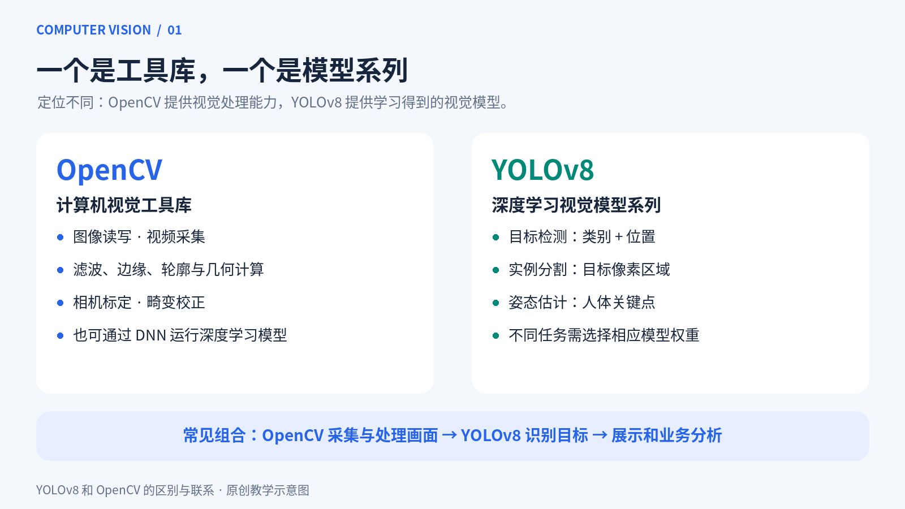
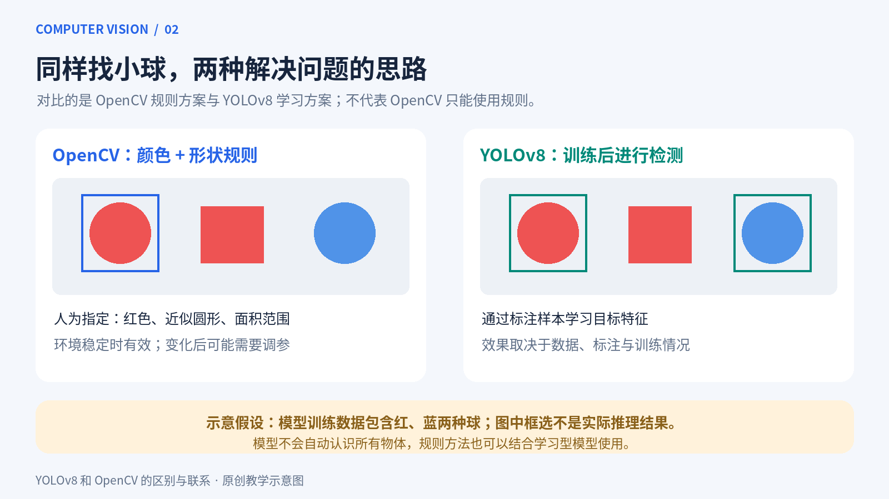
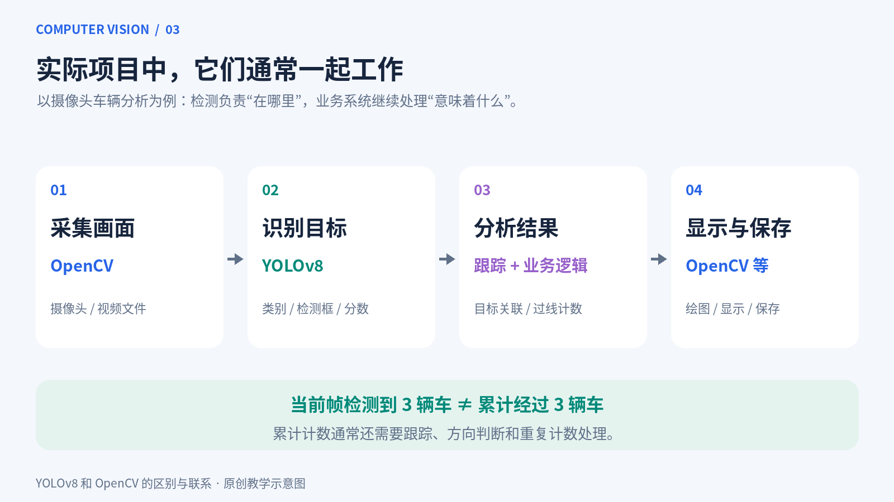
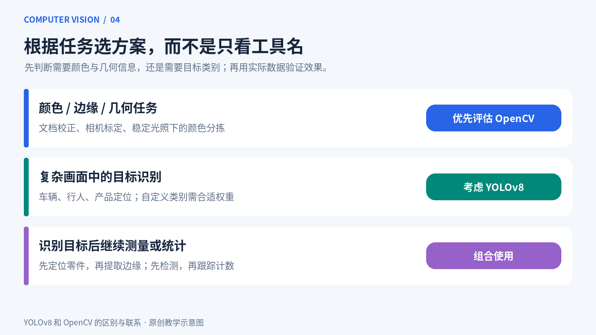

# YOLOv8 和 OpenCV 的区别与联系：从原理到应用的图文详解

在学习计算机视觉时，很多人都会遇到两个名字：OpenCV 和 YOLOv8。它们都能处理图像，也经常一起出现在摄像头检测项目中，但它们并不是同一种工具。

**OpenCV 是计算机视觉工具库，YOLOv8 是深度学习视觉模型系列。** 前者提供处理图像、视频和几何信息的工具，后者通过训练得到的模型完成目标检测等任务。

## 一、先看定位：工具库和模型有什么不同？

### OpenCV：视觉处理的工具箱

OpenCV 的全称是 Open Source Computer Vision Library，即开源计算机视觉库。它提供图像读写、视频采集、颜色转换、滤波、边缘检测、轮廓分析、相机标定等功能。

例如，将手机拍摄的歪斜文档校正为正视图，主要涉及边界提取和透视变换；测量固定工位上零件的尺寸，则可能涉及相机标定、边缘定位和尺度换算。这些都是 OpenCV 擅长参与的任务。

OpenCV 不只包含传统视觉算法，也提供 DNN 模块，可以加载兼容的深度学习模型进行推理。因此，把它理解为“只能做简单图像处理”并不准确。

### YOLOv8：学习得到的视觉模型

YOLOv8 由 Ultralytics 推出，以目标检测应用最为常见，也提供实例分割、图像分类、姿态估计等任务的模型。

以目标检测为例，它主要回答两个问题：**画面里有什么？目标在哪里？** 输出通常包含类别、边界框和置信度。

假如模型在街道图片中检测到一辆汽车，就会给出汽车的类别和矩形位置。置信度是模型对这次检测的评分，不应直接等同于经过校准的正确概率。

不同任务需要选择相应的模型或权重。普通检测权重不会自动同时输出人体关键点和实例分割掩码。

## 二、再看原理：写规则与学习特征

*图中的框选用于解释方法，并非实际模型推理结果。*

假设我们要从画面中寻找小球，可以采用两种思路。

### 使用 OpenCV：明确写出判断条件

开发者可以先提取红色区域，再根据面积、圆度等条件筛选候选轮廓。程序实际上是在执行“颜色接近红色，而且形状接近圆形”等规则。

在背景简单、光照稳定的环境中，这种方案可能快速有效，也不需要收集训练数据。但当光照改变、目标被遮挡，或者背景出现相似物体时，规则可能需要重新调整。

### 使用 YOLOv8：从标注样本中学习

采用 YOLOv8 时，通常需要准备图片，标注小球的位置与类别，再训练模型。训练过程会调整模型参数，使预测逐渐接近标注结果。

如果数据涵盖不同颜色、角度、光照和遮挡情况，模型更有机会适应这些变化。不过，效果仍取决于数据质量、标注和训练配置。

图中假设训练数据包含红、蓝两种球，所以学习方案示意框出了两种颜色的球。这不表示模型天然认识所有球，也不表示它永远不会误检。

**这里比较的是两种具体方案。OpenCV 也能调用学习型模型，规则方法也可以与深度学习结合。**

## 三、核心区别对照

| 对比维度 | OpenCV | YOLOv8 |
|---|---|---|
| 本质 | 计算机视觉工具库 | 深度学习视觉模型系列 |
| 常见任务 | 图像处理、视频处理、几何计算 | 检测、分割、分类、姿态估计 |
| 能力来源 | 所选择的算法和模型 | 训练数据与学习得到的参数 |
| 是否需要训练 | 取决于方法，基础处理通常不需要 | 预训练权重可直接推理，自定义任务通常需要训练 |
| 常见输出 | 图像、边缘、轮廓、特征点、几何参数 | 类别、检测框、掩码、关键点 |

一个关键区别是：**轮廓信息不等于类别信息。** 找到一个矩形轮廓，并不能仅凭这一点知道它是手机、书本还是屏幕。

反过来，检测出“零件”也不代表已经得到精密尺寸。识别、定位和测量是相关但不同的任务。

## 四、两者如何联系起来？

以车辆分析系统为例，OpenCV 可以打开摄像头并读取画面，YOLOv8 对每一帧执行检测，业务程序根据结果进行跟踪或计数，最后再显示或保存处理后的画面。

OpenCV 读取的图像通常以 NumPy 数组表示，Ultralytics 的预测接口可以直接接收这种输入，所以两者衔接比较方便。

得到检测框后，开发者可以使用 OpenCV 绘制矩形、文字和计数线。Ultralytics 也提供绘图接口，不必每次都手动画框。

### 检测数量不等于累计数量

假设一辆车在镜头中停留了 100 帧，模型可能在每一帧都检测到它。如果把各帧检测数量直接累加，同一辆车就可能被重复统计。

因此，“当前画面有几辆车”可以通过检测结果统计；“一小时内经过多少辆车”通常还需要多目标跟踪、过线判断和重复计数处理。ByteTrack、BoT-SORT 等跟踪方法可以参与这一过程。

### 部署时也可以结合

YOLOv8 可以导出为 ONNX 等格式，在确认版本与算子兼容后，通过 OpenCV DNN 执行推理。这种方案需要正确处理输入缩放、颜色顺序、归一化、输出解析及必要的后处理。

这不意味着 OpenCV 能直接加载任意 YOLOv8 `.pt` 权重，而是说明二者可以出现在同一条部署链路中。

## 五、实际项目怎么选？

### 颜色、边缘和几何规律明确：先评估 OpenCV

文档校正、相机标定、固定光照下的颜色分拣，都可以优先考虑明确的图像处理或几何方法。这些问题未必需要目标检测模型。

### 复杂场景中识别物体：考虑 YOLOv8

行人检测、车辆检测、产品定位等任务，需要从复杂画面中提取类别与位置，适合评估 YOLOv8 这类模型。

但常见通用预训练权重只支持其训练类别。安全帽、特定零件或特殊缺陷等目标，可能需要专用权重或自行训练。模型能识别什么，主要取决于任务、训练数据和权重。

### 识别后还要测量或统计：组合使用

例如，工业检测可以先用 YOLOv8 定位零件，再用 OpenCV 对局部区域进行边缘提取、几何分析和尺寸计算。车辆统计则可以结合检测、跟踪、过线逻辑和视频显示。

另外，YOLOv8 的矩形检测框通常不应直接作为精密测量边界：模型定位误差、镜头畸变和拍摄透视都会影响结果。

## 六、关于速度和准确率的常见误解

**不能笼统地说 YOLOv8 比 OpenCV 更准确。** OpenCV 是工具库，需要明确其中使用了什么算法，再在同一任务和数据上比较。

**也不能简单地说 OpenCV 一定更快。** 简单阈值处理通常计算量较小，但复杂视觉流程也可能很耗时。YOLOv8 的速度受模型大小、输入分辨率、CPU/GPU 和推理后端等因素影响。

测试时，应区分模型推理耗时和完整流程耗时。摄像头读取、图像传输、绘图与视频保存，都可能影响最终帧率。

判断识别效果则应关注精确率、召回率、mAP 等指标，并检查实际场景中的误检与漏检。只看演示图片上的高置信度框，不足以判断系统是否可靠。

## 结语

OpenCV 提供处理图像、视频和几何信息的工具，YOLOv8 提供通过训练完成视觉任务的模型。开发项目时，先拆解采集、识别、测量、跟踪和统计等环节，再选择各自适合的方法，就能理解两者为什么经常一起使用。

### 延伸阅读

- [OpenCV 官方文档](https://docs.opencv.org/4.x/)
- [Ultralytics YOLOv8 文档](https://docs.ultralytics.com/models/yolov8/)

文中四张图片均为原创教学示意图，不代表性能测试或实际检测结果。
